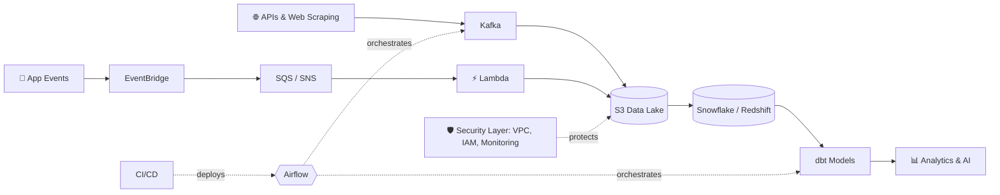

 

---

## 🧭 Quick Navigation

| 🚀 Start | 🧠 Learn | 🛠️ Build | 📬 Connect |
|:--|:--|:--|:--|
| [About me](#-about-me) | [Skills](#-skills--tech-arsenal) | [Featured projects](#-featured-projects) | [Contact](#-lets-connect) |
| [Terminal](#-whoami) | [Cloud & AWS](#️-cloud--aws-services) | [Pipeline diagram](#-how-i-build-data-pipelines) | [Back to top](#) |
| [What I do](#-what-i-do) | [Security toolkit](#️-cyber-security-toolkit) | [GitHub stats](#-github-stats) | |

---

## 💻 whoami

  

---

## 👋 About Me

I'm a **multi-disciplinary technologist** working across **cloud data engineering**, **AI engineering** and **cyber security**. I combine solid engineering with a security-first mindset, so the systems I build are reliable, scalable and resilient.

Currently I'm going deep into **DevOps engineering**, with a focus on **CI/CD** pipelines. I also use AI to speed up how I build web apps, tools and automation.

| 🔭 Focus | 🌱 Learning | 🛡️ Mindset |
|:--|:--|:--|
| Cloud data pipelines, security research, DevOps | CI/CD, DevOps, cloud-native architecture | Build secure. Scale smart. Ship fast. |

---

## 🎯 What I Do

<table>
<tr>
<td width="33%" valign="top">

### ☁️ Cloud Data Engineer
- Design ETL / ELT pipelines
- Stream data with **Kafka**
- Orchestrate with **Airflow**
- Transform with **dbt** and **SQL**
- Warehouse on **Snowflake**, **Redshift**, **Fabric**
- Web scraping and data fetching

</td>
<td width="33%" valign="top">

### 🤖 AI Engineer
- AI-powered development workflows
- Building web apps, tools and software faster with AI
- Automation scripts and data utilities
- Combining data pipelines with AI features

</td>
<td width="33%" valign="top">

### 🛡️ Cyber Security Specialist
- Web pentesting
- Reverse engineering
- OSINT research
- Digital forensics investigation
- Security assessments and vulnerability hunting

</td>
</tr>
</table>

---

## 🧰 Skills & Tech Arsenal

### 💬 Languages

### 📊 Data Engineering

### ☁️ Cloud & DevOps

### 🛡️ Security & OS

<!--
TODO (confirm before uncommenting): add any of these only if you really use them

-->

  

---

## ☁️ Cloud & AWS Services

| Layer | Services I work with |
|:--|:--|
| ⚡ **Compute** | AWS Lambda · Amazon EC2 |
| 📨 **Messaging & Events** | Amazon SNS · Amazon SQS · Amazon EventBridge |
| 🗄️ **Storage & Warehouse** | Amazon S3 · Amazon Redshift · Snowflake · Microsoft Fabric |
| 🌐 **Networking** | Amazon VPC |
| 🔄 **Streaming & Orchestration** | Apache Kafka · Apache Airflow · dbt |
| 🔷 **Azure** | Azure cloud services · KQL queries · Microsoft Fabric |
| 🟢 **Backend / DB** | Supabase |

---

## 🛡️ Cyber Security Toolkit

| Domain | Tools & Skills |
|:--|:--|
| 🌐 **Web Pentesting** | Burp Suite · Hydra · Metasploit |
| 🔍 **Recon & Scanning** | Nmap · SpiderFoot |
| 🕵️ **OSINT Research** | SpiderFoot · open-source intelligence gathering |
| 🧬 **Reverse Engineering** | Analysing binaries and software behaviour |
| 🧪 **Digital Forensics** | Investigating and analysing digital evidence |
| 📚 **Foundations** | Cyber Security Fundamentals (certified) |

> [!NOTE]
> All security work is done ethically: labs, CTFs, authorised assessments and education only.

---

## 🔄 How I Build Data Pipelines

---

## 🚀 Featured Projects

| Project | What it is | Link |
|:--|:--|:--|
| 🐰 **Bunny Ecosystem** | Open-source ecosystem: the **Axiom** language (`bite` CLI), the **Power Bash** onion-routing browser, and the long-term **Bunny-OS** microkernel goal | <!-- TODO: add repo link --> |
| ⚔️ **Swordflow** | Vite + pnpm project deployed with GitHub Pages | [uzankhan/Swordflow](https://github.com/uzankhan/Swordflow) |
| 🌐 **Subnetting Practice Lab** | Single-file HTML app: CIDR calculator, learn mode, practice lab, quiz and stats | <!-- TODO: add repo link --> |
| 🛡️ **Cyber Knights** | Cybersecurity education portal with a 3D animated Three.js background | <!-- TODO: add repo link --> |
| 🧠 **ProjectPilot / NeuraDock** | AI agent for project summaries and diagrams, plus a local Docker/Ollama CLI engine | <!-- TODO: add repo link --> |

> 📂 **20+ public repositories** — websites, security tools and automation scripts. [Browse all →](https://github.com/uzankhan?tab=repositories)

---

## 🏆 Certifications & Achievements

| 🏅 | Achievement |
|:--|:--|
| ❄️ | Snowflake certifications (multiple badges) |
| 🛡️ | Cyber Security Fundamentals certification |
| 📈 | Digital Marketing certification |
| 🏁 | Participant in 2 cyber security competitions / workshops |
| 📦 | 20+ public repositories on GitHub |
| ☁️ | Multi-cloud experience: AWS and Azure |

---

## 📊 GitHub Stats

---

## 🌐 Let's Connect

I'm open to collaboration, networking and new opportunities.

 

> *"Build secure. Scale smart. Ship fast."*

⬆️ <a href="#">Back to top</a>

